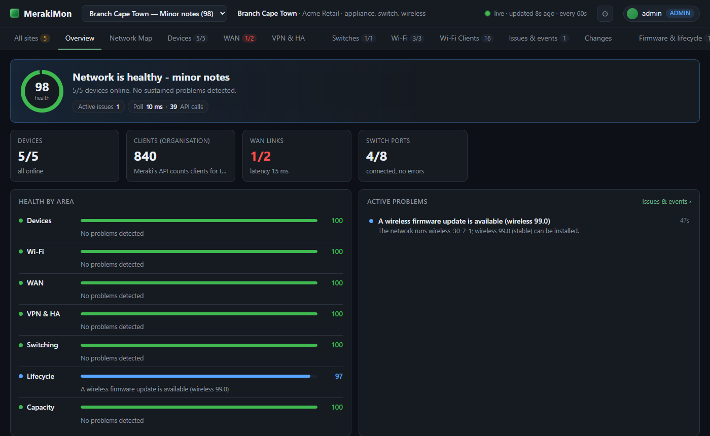
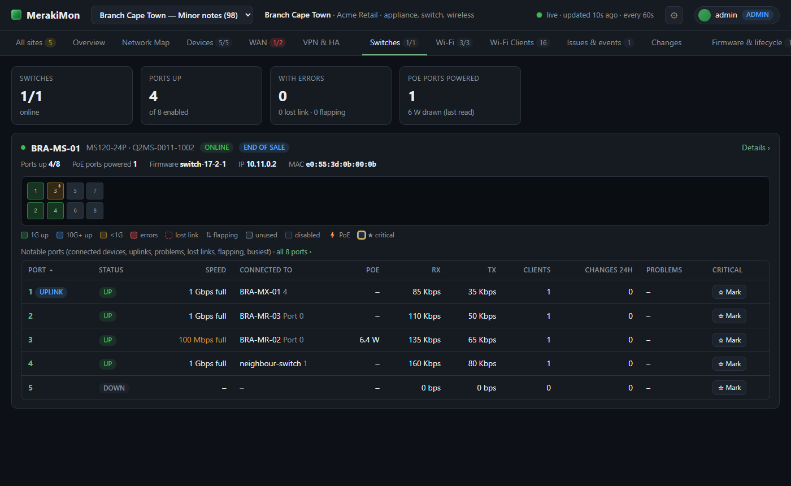

# MerakiMon

**Monitoring for Cisco Meraki that shows site health and what needs attention.** MerakiMon reads your Meraki organisations
through a read-only Dashboard API key: each Meraki network is one site, with its MX security appliances, switches, access
points, internet links, firmware and licences. It serves a live dashboard on a server you run yourself. No agents, no cloud
service of ours, and free to use.

MerakiMon is part of [MonStack](https://github.com/RowShack/MonStack), a family of monitoring apps that share one look, one sign-in model and the
same signed updates.

## What it does

- **Overview, Devices and WAN** with health checks that turn readings into issues, shown on **Issues & events**, with
  acknowledge, mute, score exclusions and critical switch ports.
- **Switches.** Each switch as a card with its port grid, facts and the notable ports; a stack is one box with its members.
  Port traffic, PoE watts, clients and the LLDP/CDP neighbour fill in over the first minutes. MerakiMon keeps its own record of
  each port's link changes, so lost links and flapping ports show up.
- **Wi-Fi.** A card per access point (state, SSIDs, each radio's channel, width, power and channel utilisation), the wireless
  clients and the failed connection attempts by step (association, authentication, DHCP, DNS).
- **Capacity forecasts** for switch ports, WAN traffic and clients. A forecast under 30 days (7 critical) is an issue.
- **Firmware and lifecycle** (end-of-life dates), **Changes** from Meraki's configuration change feed, and **Reports**.
- **Reports, alerts and a wallboard**, users with roles, two-step sign-in, backup and restore, signed in-app updates.
- **Demo mode** with simulated organisations, so you can look around without a Meraki account.
- **SiteMon.** MerakiMon serves a summary card that [SiteMon](https://github.com/RowShack/SiteMon) can show on one wallboard
  with your other MonStack apps.

**Built from the Meraki documentation, not yet checked on real gear:** the **VPN & HA** tab (site-to-site VPN and the warm
spare pair), the **Network Map** and **Find Device**. The organisation MerakiMon was checked on has no VPN, no HA pair and an
empty link-layer topology, so these tabs have only been exercised against a simulated Meraki. Treat them as new.

## Quick install

Download the files from the [latest release](https://github.com/RowShack/MerakiMon/releases/latest).

- **Windows:** double-click `MerakiMon-<version>.msi` and answer the questions (run as a service, who may connect, port).
- **Linux:** `sudo sh merakimon-<version>-linux.run` (systemd and Python 3.9 or newer).

Open `https://<server>:6443/`, create the first admin account, then add an organisation under
**Settings > Organisations**. The [setup guide](docs/setup.md) covers the details.

## Documentation

- [Setup guide](docs/setup.md): install, make the API key in the Meraki dashboard, add an organisation.
- [Configuration reference](docs/configuration.md): every Settings section, the data folder and the command line.
- [FAQ](docs/faq.md): common problems and questions.
- [Running it safely](docs/security.md): VPN or tailnet first, `trusted_proxies`, two-step sign-in, what was checked.

## Help and feedback

- **Questions, bugs and ideas:** [open an issue](https://github.com/RowShack/MerakiMon/issues/new/choose). Please give the version and
  your operating system, and never paste API keys, passwords, configuration files or customer data.
- **Security problems:** please do not use public issues. See [SECURITY.md](SECURITY.md) to report them privately.
- The other apps and the overall picture: [MonStack](https://github.com/RowShack/MonStack).

## Licence

MerakiMon is free to use and closed source. Read the [licence](LICENSE): you may install and use it, but not copy, sell,
modify or reverse engineer it.

Cisco and Meraki are trademarks of their owners. MerakiMon is an independent product and is not affiliated with or endorsed
by them.
